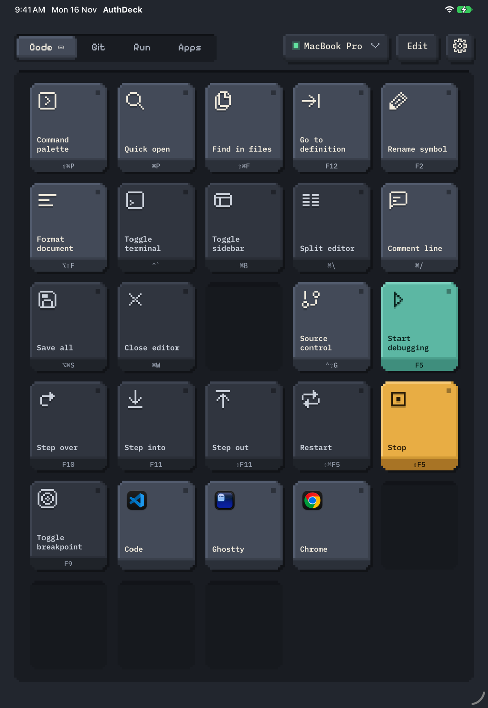
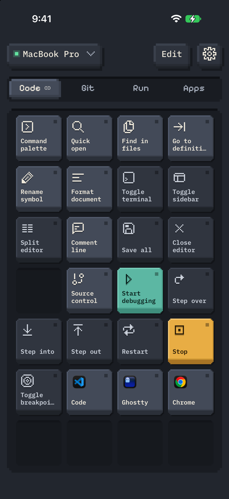
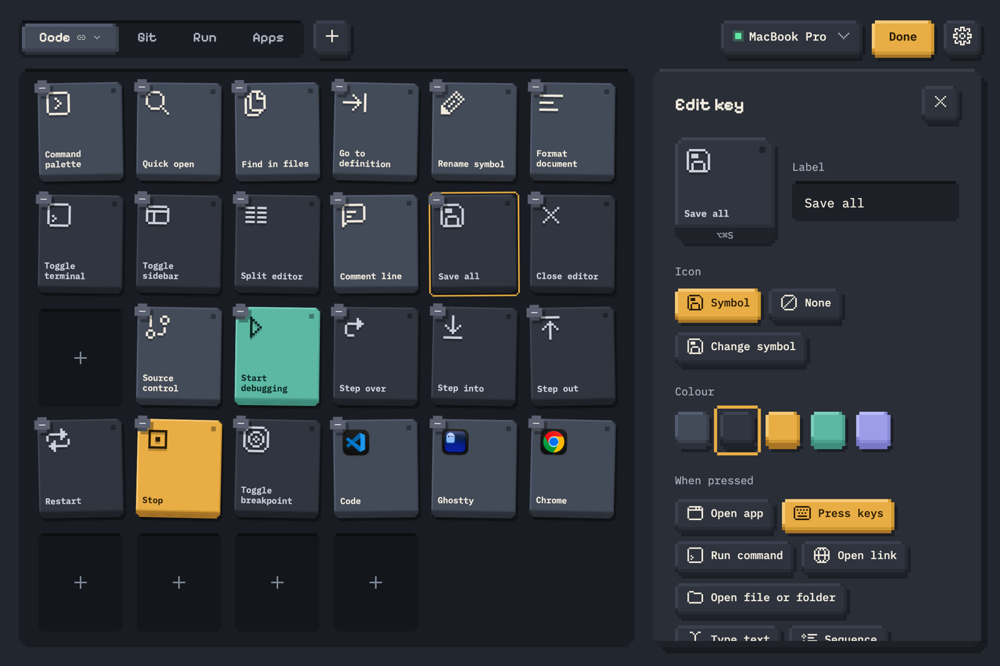
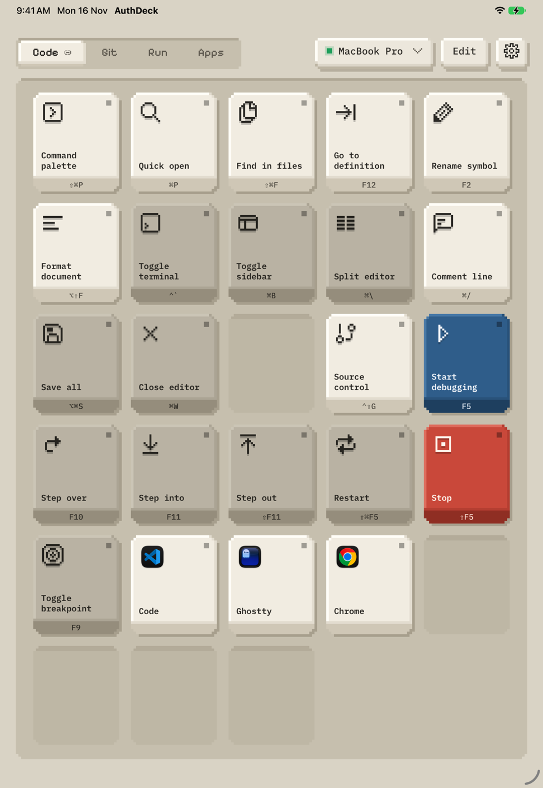
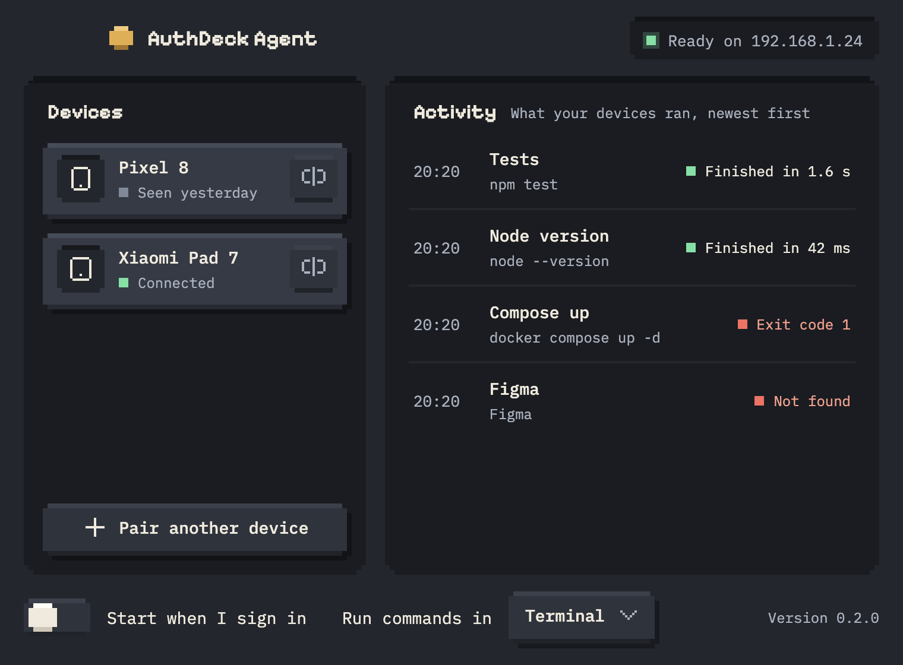
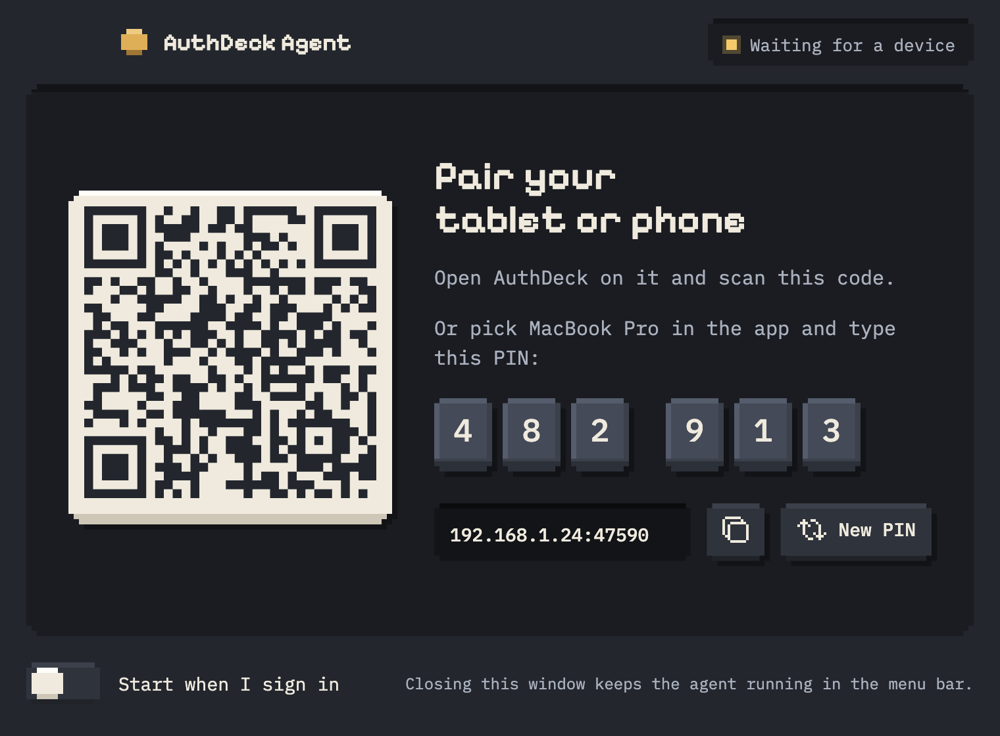

# AuthDeck

AuthDeck turns a spare tablet or phone into a deck of keys for the computer you code on. Tap a key and your computer opens an app, presses a shortcut, runs a command or opens a link.

<p>
  
  
</p>

There are two pieces:

- **The app** runs on Android and iOS and shows the keys. It also runs in a browser.
- **AuthDeck Agent** runs on your Mac, Windows or Linux computer and does what the keys ask.

They talk to each other over your own network. There's no account and no server in between.

## What a key can do

- Open an app. The picker lists what's installed on your computer, icons included.
- Press a keyboard shortcut, optionally bringing a specific app to the front first.
- Type a snippet of text.
- Run a command in a new terminal window, or quietly in the background and show you the output and exit code.
- Open a link, a file or a folder.
- Do several of these in a row.

You start with four pages (Code, Git, Run and Apps) set up for VS Code on your platform. Tap Edit to move keys around, change what they do or add your own. Long-press a key for its menu. AuthDeck can also switch pages on its own when you change apps on your computer.

Keys click when you press them (you can turn that off), a small light on each key shows how its last run went, and a running command marches a line of pixels around its key. There are three colour schemes: Graphite, Paper and Tide.

## Env sets

Coming in 0.4. An env set keeps a project's `.env` secrets in the project's own git repo, in one file, `.authdeck/<set>.env`. Names are in clear, values are encrypted so that only member phones and tablets can open them, and every line is signed by the device that wrote it.

- Your phone approves every release. `authdeck env run -- npm run dev` asks it, and the values go into that one process; no file is written. "Allow for 15 minutes" lets the next runs on that computer go through without a tap.
- The computer never stores a set's key. A lost laptop gives up only ciphertext, plus any `.env` you pulled onto it.
- The file shows variable names and who is in the set (each member is labelled with the person's name and device name), never values.
- Your own devices join with a six-digit check code. A teammate asks to join with a request file in the repo, and you each read your six key words out and the other picks each one from three choices before you approve.
- Removing someone makes a new key and lists the variables to rotate.
- No server: the repo carries the file, and the phone talks to the computer over the same encrypted link as the deck.

A computer you allow sees the values while the process runs, and for as long as a 15-minute grant lasts. [docs/env.md](docs/env.md) has the file format, every command and the full threat model.

### CLI quick start

`authdeck` ships inside AuthDeck Agent and runs through the app's own CLI mode, so no other program can use the app to run its own code with the app's permissions; "Put the authdeck command on your PATH" in its window adds it. Run it in a git working tree, with the agent running and AuthDeck open on a phone paired with this computer.

```sh
authdeck env init --from .env          # make a set from .env; your phone creates it and becomes its owner
git add .authdeck .gitattributes && git commit -m "Add env set"

authdeck env run -- npm run dev        # your phone approves; values go into npm run dev only
authdeck env push .env.local           # send changes (default file .env); your phone signs them; --prune also removes names
authdeck env pull                      # write .env (mode 0600, quoted so a shell reads it as data); --force replaces one
authdeck env ls                        # sets here, members, your role, open grants, join requests
```

`run` leaves out variables that make programs load code or turn off TLS checks (`NODE_OPTIONS`, `LD_PRELOAD`, any `GIT_*`, compiler flags and the like), since any member can set them; add `--allow NAME` to use one for that run. To undo a change, set the old value again from your phone rather than reverting the commit. A phone taking a set for the first time checks the file's git history, so protect branches that hold set files against force-push, and take sets from the main branch. A teammate clones the repo and runs `authdeck env init` to ask to join; you each read your six key words out and the other picks each one from three choices before you approve. With several sets in one repo, add `--set <name>`. Exit codes: 77 denied, 75 no device answered in 60 seconds (or too many requests just now), 73 `pull` found the file already there, 65 the set file or your `.env` was refused; `run` otherwise exits with its command's code. The full list is in [docs/env.md](docs/env.md#exit-codes).

## Install

### On your computer

Download AuthDeck Agent from [authdeck.in](https://authdeck.in/#download), which also lists each file's SHA-256:

| System | File |
| --- | --- |
| macOS, Apple silicon | `AuthDeck-Agent-<version>-mac-arm64.dmg` |
| macOS, Intel | `AuthDeck-Agent-<version>-mac-x64.dmg` |
| Windows | `AuthDeck-Agent-<version>-win-x64.exe` |
| Linux | `AuthDeck-Agent-<version>-linux-x86_64.AppImage` or `AuthDeck-Agent-<version>-linux-amd64.deb` |

The builds aren't signed with paid certificates yet, so the first launch takes an extra click:

- **macOS:** open the app once, then go to System Settings › Privacy & Security and click Open Anyway. macOS will also ask you to turn on AuthDeck Agent under Accessibility. Shortcuts and typing need that, while opening apps, links and commands work without it. If it asks about incoming network connections, allow them.
- **Windows:** when SmartScreen stops it, click More info, then Run anyway. When the firewall asks, allow it on private networks.
- **Linux:** shortcuts and typing need `xdotool` on X11, or `wtype` or `ydotool` on Wayland. [docs/agent.md](docs/agent.md) has the details for each desktop.

Closing the window keeps the agent running in the menu bar (or the tray on Windows and Linux). It can start when you sign in; there's a switch at the bottom of its window.

The app refuses any launch argument it doesn't use itself and exits; on Linux `--no-sandbox` is allowed, because the AppImage needs it on some distributions (Ubuntu 24.04, for one). AuthDeck Agent doesn't defend against other programs running as you on the same computer: such a program can change its settings and paired devices in `~/.authdeck`. Keep the computer free of malware.

If you'd rather run it in a terminal, the agent is also a single Node script. See [docs/agent.md](docs/agent.md).

### On your tablet or phone

- **Android:** on the device, download the APK from [authdeck.in](https://authdeck.in/#download) and open it. Android will ask you to allow installs from your browser first.
- **iPhone and iPad:** it's not on the App Store yet. [authdeck.in](https://authdeck.in/#download) has an unsigned IPA for sideloading tools that sign it with your own Apple ID, or you can build it with Xcode (see below).

### Pairing

Open the agent on your computer. It shows a QR code and a six-digit PIN. In the app, tap Scan QR code, or pick your computer from the list and type the PIN. Both devices need to be on the same Wi-Fi.

## Screenshots

Editing a key. On a phone the editor opens as a sheet instead.



The Paper colour scheme, and AuthDeck Agent on a Mac with two devices paired and waiting to pair another.

<p>
  
</p>

<p>
  
  
</p>

## Building from source

You need Node 22 or newer. For the mobile app you also need the Android SDK (with JDK 21) or Xcode.

```sh
# The agent on its own (CLI), with its tests
cd agent
npm install
npm test
npm run build            # writes dist/authdeck-agent.cjs

# The desktop app
cd desktop
npm install
npm start                # build and run it
npm run dist:mac         # or dist:win, dist:linux

# The mobile app
cd app
npm install
npx expo start           # dev server; press w for the browser version
npx expo prebuild -p android && (cd android && ./gradlew assembleRelease)
npx expo prebuild -p ios && (cd ios && pod install)   # then open ios/AuthDeck.xcworkspace in Xcode
```

Release APKs are signed with your own key when you set the `AUTHDECK_UPLOAD_*` values in `~/.gradle/gradle.properties` (see [app/plugins/withReleaseSigning.js](app/plugins/withReleaseSigning.js)). Without them they fall back to the debug key, which is fine for trying things out.

The app and the agent share one message format. `agent/src/protocol.ts` and `app/src/protocol.ts` have to stay identical, and `node scripts/check-protocol.mjs` checks that they do.

## How it's laid out

```
app/       the Expo app for Android, iOS and the browser
agent/     the agent: pairing, the WebSocket server and every action for macOS, Windows and Linux
desktop/   AuthDeck Agent, the Electron app that wraps the agent with a window and a tray icon
docs/      the agent, authenticator and env set guides, and the screenshots
site/      the website, its build and how it's published (site/README.md)
scripts/   repo checks
```

## Security

The connection between the app and the agent is encrypted, and both ends prove who they are: pairing by QR code or PIN exchanges keys, each PIN attempt is one guess, and three wrong PINs bring a new PIN and a pause. A paired device can run commands as you, so only pair devices you own, and unpair a lost one from the agent window. [docs/agent.md](docs/agent.md#security) has the details. For env sets, see [Threat model and limits](docs/env.md#threat-model-and-limits).

## Credits

- [Pixelify Sans](https://github.com/eifetx/Pixelify-Sans) by Stefie Justprince, under the SIL Open Font License. The copy in `app/assets/fonts` has its fi and fl ligatures removed, because they read as other letters at small sizes.
- [IBM Plex Mono](https://github.com/IBM/plex), under the SIL Open Font License.
- [pixelarticons](https://github.com/halfmage/pixelarticons) by Gerrit Halfmann, under the MIT License.
- The key sounds are synthesised by [app/scripts/gen-sounds.mjs](app/scripts/gen-sounds.mjs).

## Support

AuthDeck is free, with no ads and no account. If it's useful to you, you can [buy me a coffee](https://buymeacoffee.com/adultcudi).

## License

AuthDeck is under the Functional Source License, version 1.1, MIT Future License (FSL-1.1-MIT). You may read, use, change and self-host it for free, for yourself or your company. You may not offer it, or a product built from it, as a commercial product or service that competes with AuthDeck. Two years after each release is published, that release is also available under the MIT License. The full terms are in [LICENSE](LICENSE).
